# 01. System Overview

This chapter describes the system as a whole: what it is for, which components
it has, how they connect, and the design rules that hold across all of them.
Later chapters zoom into hardware ([02](02-hardware-and-infrastructure.md)),
the cluster ([03](03-cluster-design.md)), each module ([04-modules/](04-modules/))
and the data ([05](05-data-flow.md), [06](06-database.md)).

## 1. Purpose and scope

| Question | Answer | Confidence |
|---|---|---|
| What problem does the system solve? | Build a multilingual (Arabic, English, French) news archive from CC-NEWS and answer questions over it with cited evidence. | Verified in code: `ingestion/text.py:17-21`, `retrieval/agent.py:28-63` |
| Who uses the answers? | [[FILL: intended end users of the question-answering output]] | Blank |
| What is the project context (course, research, product)? | [[FILL: project context and sponsor (for example course, research group, company)]] | Blank |
| Which languages are kept? | `ar`, `en`, `fr` only; every other language is rejected at ingestion. | Verified in code: `ingestion/text.py:17-21`, `ingestion/extraction.py:18` |
| Which time range of news is covered? | Selected per ingestion run by `YEAR`/`MONTH` (default `2026/05`). The exported snapshot contains only `2026/05` files. | Verified in code: `ingestion/pipeline.py:100-101`; `exports/pages.csv` (`source_file_url`) |
| Target corpus size | [[FILL: target number of articles or months to ingest for the project]] | Blank |

## 2. System context

Data flows left to right. CC-NEWS files are ingested by Spark into the article
tables, three independent Spark stages derive chunks, tags and vectors, and the
RAG agent answers questions from the chunk and vector tables with help from an
external LLM. The query service on the right is proposed and does not exist yet.

*Source: docs/diagrams/src/system-context.mmd*

| Node | What it is | Runs where | Confidence |
|---|---|---|---|
| CC-NEWS archive | Public WARC files and monthly manifests at `data.commoncrawl.org`, read over HTTPS with byte-range requests. | Internet | Verified in code: `ingestion/pipeline.py:160-179, 223-250` |
| Spark ingestion | `ingestion/` package. The driver schedules waves and commits; executors download, parse, extract and classify. | YARN cluster, client mode | Verified in code: `ingestion/pipeline.py:500-604`, `scripts/run_processing.sh:141` |
| Article tables | `websites`, `authors`, `pages`, `metadata`, `content` plus ingestion bookkeeping tables. | PostgreSQL | Verified in code: `db/db_handler.py:81-135` |
| Chunk, tag, embed | Three independent Spark jobs: `chunking/`, `tagging/`, `embeddings/`, sharing `jobs/`. Tagging calls the Groq API from executors. | YARN cluster, client mode | Verified in code: `chunking/pipeline.py`, `tagging/pipeline.py`, `embeddings/pipeline.py`, `jobs/runtime.py:106-119` |
| Chunks and vectors | `chunk_materializations`, `article_chunks`, `chunk_analyses`, `chunk_embeddings` (pgvector `VECTOR(1024)`). | PostgreSQL (same database) | Verified in code: `db/enrichment_schema.py`, `db/vector_schema.py` |
| RAG agent CLI | `retrieval/` package driven by `scripts/ask.py`: plan, search, rerank, answer. Not on Spark. | One local Python process ([[FILL: machine that runs scripts/ask.py]]) | Verified in code: `scripts/ask.py`, `sparc_baseline/README.md:277-278` |
| Groq / Gemini APIs | Hosted LLMs used for query planning and answering (`openai/gpt-oss-120b` on Groq by default, or `gemini-3.5-flash-lite`). | Internet | Verified in code: `retrieval/llm.py:15-20` |
| Query service | A FastAPI HTTP service in `query_service/`. The folder contains only an empty `__init__.py`. | Proposed (not implemented) | Verified in code: `query_service/__init__.py` (0 bytes) |

## 3. Components at a glance

| Component | Package | Entry point | Python environment | Execution | Confidence |
|---|---|---|---|---|---|
| Ingestion | `ingestion/` | `scripts/run_ingestion.sh` → `scripts/ingest.py` | `.venv` (`requirements/base.txt`) | Spark on YARN | Verified in code: `scripts/run_ingestion.sh:3`, `scripts/run_processing.sh:18,29` |
| Chunking | `chunking/` | `scripts/run_chunking.sh` → `scripts/chunk.py` | `.venv` (`requirements/rag.txt`) | Spark on YARN | Verified in code: `scripts/run_chunking.sh:3`, `scripts/run_processing.sh:28` |
| Tagging | `tagging/` | `scripts/run_tagging.sh` → `scripts/tag.py` | `.venv` (`requirements/tagging-groq.txt`) | Spark on YARN | Verified in code: `scripts/run_tagging.sh:3`, `scripts/run_processing.sh:30` |
| Embeddings | `embeddings/` | `scripts/run_embeddings.sh` → `scripts/embed.py` | `.venv-embedding-onnx` (`requirements/embedding-worker-onnx.txt`) | Spark on YARN | Verified in code: `scripts/run_processing.sh:19-21,31` |
| Retrieval / RAG agent | `retrieval/` | `scripts/ask.py` | `.venv-rag` (`requirements/rag-agent.txt`) | Local process | Verified in code: `scripts/ask.py`, `sparc_baseline/README.md:230-235` |
| Persistence | `db/` | Library; `scripts/inspect_db.sh` | Any of the above | Driver or local | Verified in code: `db/db_handler.py`, `scripts/inspect_db.sh:10` |
| Shared job runtime | `jobs/` | Library; `jobs/environment.py`, `jobs/launch_config.py` used by launchers | `.venv` | Driver and launcher | Verified in code: `jobs/runtime.py`, `scripts/run_processing.sh:11,38` |
| Operational scripts | `scripts/` | Shell and Python commands | Mixed | Master / operator machine | Verified in code: `scripts/` |
| Query service | `query_service/` | None | None | Proposed (not implemented) | Verified in code: `query_service/__init__.py` (empty) |

Detailed module descriptions are in [04-modules/](04-modules/).

## 4. How the stages connect

The stages never call each other. They communicate only through PostgreSQL
rows and shared version keys, so each stage can be run, stopped and rerun on
its own. *Verified in code: each pipeline reads its pending rows with a SQL
`NOT EXISTS`/`LEFT JOIN` on the stage's output table: `db/chunks.py:28-40`,
`db/analyses.py:14-27`, `db/embeddings.py:13-34`.*

| From | To | Contract (what links them) | Confidence |
|---|---|---|---|
| Ingestion | Chunking | Rows in `pages` + `content.cleaned_text`. Chunking selects pages without a `chunk_materializations` row for the current `chunking_version`. | Verified in code: `db/chunks.py:28-40` |
| Chunking | Tagging | Eligible `article_chunks` rows of a `chunking_version` without a `chunk_analyses` row for the same backend, model and `analysis_version`. | Verified in code: `db/analyses.py:14-27` |
| Chunking | Embeddings | Eligible `article_chunks` rows without a `chunk_embeddings` row for the same `embedding_model` and `embedding_version`. | Verified in code: `db/embeddings.py:13-34` |
| Embeddings | Retrieval | `chunk_embeddings` filtered by `chunking_version`, `embedding_model` and `embedding_version`. The query must be embedded with the same model files and `max_length`. | Verified in code: `retrieval/store.py:33-46, 65-82` |
| Tagging | Retrieval | None. Retrieval does not read `chunk_analyses`. | Verified in code: `retrieval/store.py:65-82` (no join on `chunk_analyses`) |

Consequences:

- Chunking, tagging and embedding can run in any order and at the same time,
  because each holds its own advisory lock. *Verified in code: `db/chunks.py:13-25`,
  `jobs/runtime.py:22`.*
- Only one ingestion coordinator can run against a database at a time, across
  all manifests. *Verified in code: `db/db_handler.py:192-203` (one fixed lock key).*
- New articles become searchable only after chunking **and** embedding have
  been rerun. Nothing triggers them automatically. *Verified in code: no
  scheduler or trigger exists in the repository.*

## 5. Design principles that hold across the system

| Principle | What it means in practice | Confidence |
|---|---|---|
| Driver-owned database writes | Executors never open database connections. The driver reads pending work, ships bounded task payloads, and commits results. | Verified in code: `ingestion/pipeline.py:353-354`, `chunking/pipeline.py:37-46`, `tagging/pipeline.py:44-57`, `embeddings/pipeline.py:37-47` |
| Bounded work units | Every task has count and byte limits for input and output; oversized results fail explicitly. | Verified in code: `jobs/batching.py:8-35`, `ingestion/pipeline.py:331-336` |
| Idempotent, resumable commits | Re-running a command continues where it stopped. Ingestion uses commit receipts and byte checkpoints; the other stages use primary keys and `NOT EXISTS` selection. | Verified in code: `db/db_handler.py:343-347`, `db/chunks.py:43-69`, `db/embeddings.py:70-82` |
| Versioned identities | Changing the chunking rules, tagging prompt or embedding model creates new rows instead of overwriting old ones. | Verified in code: primary keys in `db/enrichment_schema.py:10,22,43`, `db/vector_schema.py:15` |
| Single-coordinator locks | PostgreSQL advisory locks prevent two coordinators of the same stage from running at once. | Verified in code: `db/db_handler.py:192-203`, `db/chunks.py:13-25` |
| Fail loudly, no silent fallback | Hash mismatches, missing model files, non-normalised vectors and unscored hits raise errors. | Verified in code: `db/embeddings.py:47-56`, `retrieval/reranker.py:98-100`, `retrieval/evidence.py:30-32` |
| Secrets stay out of archives and logs | The Groq key reaches executors through Spark executor environment with redaction rules; error messages replace the key with `[REDACTED]`. | Verified in code: `jobs/runtime.py:97-98, 106-110, 135-138`, `tagging/backends/groq.py:72` |
| Lightweight imports | Package `__init__` files load no models and open no connections, so ingestion runs without RAG dependencies. | Verified in code: `tagging/backends/__init__.py:1`, `tests/test_packaging.py` |

## 6. Python environments

The project deliberately uses three separate virtual environments so that heavy
or optional dependencies do not leak into the Spark worker archives.

| Environment | Requirements file | Used by | Packaged for YARN? | Confidence |
|---|---|---|---|---|
| `.venv` | `requirements/base.txt` (ingestion), `rag.txt` (+ LangChain splitters), `tagging-groq.txt` (+ Groq), `dev.txt` (+ `warcio` for tests) | Ingestion, chunking, tagging, `inspect_db.sh`, tests, the `.env` loader | Yes (`venv-pack`) | Verified in code: `scripts/run_processing.sh:6-12, 69-87`, `requirements/*.txt` |
| `.venv-embedding-onnx` | `requirements/embedding-worker-onnx.txt` (no PyTorch) | Embedding stage, `watch_embeddings.sh`, `vector_search_test.py` | Yes, together with the model archive | Verified in code: `scripts/run_processing.sh:19-21`, `scripts/setup_embedding_onnx_env.sh` |
| `.venv-rag` | `requirements/rag-agent.txt` | `scripts/ask.py`, reranker download | No (local only) | Verified in code: `scripts/download_quantized_reranker_model.sh:9`, `sparc_baseline/README.md:230-235` |
| (none yet) | `requirements/embeddings.txt` (FastAPI, Uvicorn, pgvector, ONNX) | Described as "the optional retrieval API"; no code uses FastAPI today. | No | Verified in code: `requirements/embeddings.txt:4-7`; no `fastapi` import in the repository |

## 7. External dependencies

| Dependency | Used for | Called from | Confidence |
|---|---|---|---|
| `data.commoncrawl.org` | Monthly manifest and WARC files | Driver (manifest) and executors (WARC files) | Verified in code: `ingestion/pipeline.py:160-179, 223-231` |
| `huggingface.co` | One-time download of the INT8 ONNX embedding graph and the reranker | Operator machine running the download scripts | Verified in code: `scripts/download_quantized_embedding_model.sh:38`, `scripts/download_quantized_reranker_model.sh:34` |
| Groq API | Tagging (executors) and RAG planning/answering (local) | Executors, RAG process | Verified in code: `tagging/backends/groq.py:27-30`, `retrieval/llm.py:61-72` |
| Google Gemini API | Optional RAG provider | RAG process | Verified in code: `retrieval/llm.py:75-92` |
| HDFS | Cache of packaged environments, model archive and Spark jars | Launcher, YARN containers | Verified in code: `scripts/run_processing.sh:89-127` |
| VMware shared folder `/mnt/hgfs/copy_path/warcdb_csv` | Destination for CSV exports | `scripts/export_csv.sh` | Verified in code: `scripts/export_csv.sh:11` |

Account and quota details for the external services are unknown:
[[FILL: Groq account tier and rate limits (requests per minute, tokens per minute, tokens per day)]],
[[FILL: whether a Gemini API key exists and which account it belongs to]].

## 8. Current data snapshot

The repository contains CSV exports produced by `scripts/export_csv.sh`. They
show what the database held when they were exported, not necessarily today.

| Table | Rows in export | Notes | Confidence |
|---|---|---|---|
| `pages` / `metadata` / `content` | 2,000 each | From 335 WARC files of manifest `2026/05`; created 2026-09-30 14:36 to 14:55. Languages: en 1,627, fr 221, ar 152. Extraction: trafilatura 1,881, selectolax 119. | Verified in code: `exports/pages.csv`, `exports/metadata.csv` |
| `websites` / `authors` | 729 / 1,053 | Distinct domains and author names | Verified in code: `exports/websites.csv`, `exports/authors.csv` |
| `chunk_materializations` | 2,000 | All with `chunking_version = recursive-800-100-clean-v2.4.1-v1` | Verified in code: `exports/chunk_materializations.csv` |
| `article_chunks` | 11,953 | 10,145 eligible; 1,808 filtered (short 800, headlines 789, blocked 121, aggregator 39, bio 30, garbled 21, non_article_url 8) | Verified in code: `exports/article_chunks.csv` |
| `chunk_analyses` | 60 | Groq `qwen/qwen3.8-27b`, `chunk-analysis-v2.4.1`: 49 SUCCESS, 6 NOISE, 5 ERROR; created 2026-10-05 | Verified in code: `exports/chunk_analyses.csv` |
| `chunk_embeddings` | 911 | `BAAI/bge-m3-int8`, version `bge-m3-int8-9fb3afc85bfa0f8662dd`; created 2026-10-07 | Verified in code: `exports/chunk_embeddings.csv` |

So at export time, about 9% of eligible chunks (911 of 10,145) were searchable
and 0.6% (60) were tagged. *Inferred: arithmetic on the export counts.*
Current database state: [[FILL: current row counts of pages, article_chunks, chunk_analyses and chunk_embeddings in the live database]].

## 9. What is outside the repository

These items are referenced by code or legacy documents but are not in the
baseline. They are recorded so that nobody searches for them in vain.

| Item | Referenced in | Status |
|---|---|---|
| `cluster_up.sh`, `cluster_down.sh` (start/stop VMs and Hadoop) | `sparc_baseline/README.md:94-96` | Not in repo. [[FILL: location and contents of cluster_up.sh and cluster_down.sh]] |
| `clean_results.py` (copy of the noise rules) | `tagging/backends/groq_rules.py:58` | Not in repo. [[FILL: location of clean_results.py and whether it is still used]] |
| `run_to_db.sh` (older launcher) | `archive/validation.md:83-84` | Not in repo; replaced by `scripts/run_ingestion.sh`. Inferred. |
| `evaluation/` dataset and `scripts/evaluate_retrieval.py` | `archive/rag-api-plan.md:19-24` | Planned, not implemented. |
| Base BGE-M3 model files in `.models/bge-m3` | `scripts/download_quantized_embedding_model.sh:8, 20-26` | Must exist before the INT8 download. Source unknown (see README quick start). |
| Modal embedding plan | Project brief | Out of scope for this documentation. |

## 10. Prototype and production at a glance

| Aspect | Prototype mode (today) | Production mode |
|---|---|---|
| Trigger | An operator runs a shell command with limits | Proposed (not implemented): an always-on ingestion service watching the CC-NEWS manifest |
| Scope of a run | Bounded by flags (`--num-files`, `--max-accepted-articles`, `--document-limit`, ...) | Proposed (not implemented): continuous, reusing the existing checkpoint tables |
| Post-ingestion stages | Started by hand | Proposed (not implemented): scheduled chunking, tagging and embedding |
| Question answering | `scripts/ask.py`, one question per process | Proposed (not implemented): FastAPI service in `query_service/` |

Details in [10-prototype-vs-production.md](10-prototype-vs-production.md).
