# 02. Hardware and Infrastructure

This chapter lists the physical and virtual machines, the software installed on
them, the network paths the system uses, and where data is stored on disk. The
code reveals only a few hardware facts, so most values here are blanks for the
team. Spark and YARN resource settings are in [03-cluster-design.md](03-cluster-design.md).

## 1. Topology

One VMware host runs a master VM and three worker VMs. The master runs the
Spark driver and the cluster services; the workers run YARN containers and
reach Internet services directly. Where PostgreSQL runs is not stated in the
code, so it is drawn dashed.

*Source: docs/diagrams/src/hardware-topology.mmd*

| Node | Role | Evidence | Confidence |
|---|---|---|---|
| VMware host | Physical machine running the VMs. Runs Debian; `cluster_up.sh` / `cluster_down.sh` start and stop the VMs and Hadoop services from here. | `sparc_baseline/README.md:94-96` ("run them on the Debian host, not inside a VM"); `/mnt/hgfs` VMware shared-folder path in `scripts/export_csv.sh:11` | Verified in code (README and script) |
| Master VM | Runs the launchers, the Spark driver (client mode), and the YARN and HDFS master services. Hostname in the legacy validation: `spark-master`, YARN ResourceManager at port 8032. | `scripts/run_processing.sh:141` (`--deploy-mode client`); `sparc_baseline/README.md:48` ("Run ingestion on the Spark master with HDFS and YARN available") | Verified in code (role); Inferred (legacy doc `archive/validation.md:80`) for hostname and port |
| 3 worker VMs | Run YARN NodeManagers and executor containers. Names in the legacy validation: `worker1`, `worker2`, `worker3`. Each has 2 GiB RAM. | `.env.example:13` ("1.5 GiB YARN container for 2 GiB worker VMs"); `archive/processing.md:102-103` | Verified in code (2 GiB, comment in `.env.example`); Inferred (legacy doc `archive/validation.md:97`) for names |
| PostgreSQL host | Holds every table. Must be reachable from the master. Default `PGHOST=localhost` suggests it runs on the master itself. | `sparc_baseline/README.md:50`; `.env.example:2`; `db/db_handler.py:21` | Inferred. [[FILL: which machine runs PostgreSQL]] |
| Internet services | CC-NEWS, Groq API, Hugging Face, optionally Gemini. | See [section 5](#5-network) | Verified in code |

## 2. Physical host

| Property | Value | Confidence |
|---|---|---|
| Hostname | [[FILL: physical host hostname]] | Blank |
| Hardware model | [[FILL: physical host hardware model]] | Blank |
| CPU model and core/thread count | [[FILL: physical host CPU model and core/thread count]] | Blank |
| RAM | [[FILL: physical host total RAM]] | Blank |
| Disks (type, size) | [[FILL: physical host disk type and size]] | Blank |
| Operating system | Debian, version [[FILL: Debian version on the physical host]] | Verified in code: `sparc_baseline/README.md:96` (Debian); version unknown |
| Hypervisor | VMware, product and version [[FILL: VMware product and version (Workstation, Player or ESXi)]] | Verified in code: `sparc_baseline/README.md:94` ("VMware host helpers") |
| Shared folder exposed to VMs | Mounted inside a VM at `/mnt/hgfs/copy_path`; host-side path [[FILL: host-side path of the copy_path shared folder]] | Verified in code: `scripts/export_csv.sh:11` |

## 3. Virtual machines

| VM | Hostname | vCPU | RAM | Disk | OS | IP address | Confidence |
|---|---|---|---|---|---|---|---|
| Master | `spark-master` (legacy doc) | [[FILL: master VM vCPU count]] | [[FILL: master VM RAM]] | [[FILL: master VM disk size]] | [[FILL: master VM operating system and version]] | [[FILL: master VM IP address]] | Hostname Inferred (legacy doc `archive/validation.md:80`) |
| Worker 1 | `worker1` (legacy doc) | [[FILL: worker1 vCPU count]] | 2 GiB | [[FILL: worker1 disk size]] | [[FILL: worker1 operating system and version]] | [[FILL: worker1 IP address]] | RAM Verified in code: `.env.example:13`; hostname Inferred (legacy doc) |
| Worker 2 | `worker2` (legacy doc) | [[FILL: worker2 vCPU count]] | 2 GiB | [[FILL: worker2 disk size]] | [[FILL: worker2 operating system and version]] | [[FILL: worker2 IP address]] | As above |
| Worker 3 | `worker3` (legacy doc) | [[FILL: worker3 vCPU count]] | 2 GiB | [[FILL: worker3 disk size]] | [[FILL: worker3 operating system and version]] | [[FILL: worker3 IP address]] | As above |

Notes:

- Spark is configured with one core per executor regardless of vCPU count.
  *Verified in code: `scripts/run_processing.sh:145`.*
- The embedding stage defaults to two executors because, with three 2 GiB
  workers and 1.5 GiB containers, the YARN application master occupies one
  worker. *Verified in code: `jobs/runtime.py:67` (default 2 for `embed`);
  reasoning from `archive/processing.md:102-103`.*
- Which machine runs `scripts/ask.py` (the RAG agent, which holds two ~570 MB
  ONNX models in memory) is unknown: [[FILL: machine that runs scripts/ask.py and its RAM]].
  *Model size: `sparc_baseline/README.md:279-281`.*

## 4. Software stack

### 4.1 System software

| Software | Required on | Version | Evidence | Confidence |
|---|---|---|---|---|
| Java (JDK/JRE) | All cluster VMs | [[FILL: Java version on the cluster]] | Required by Spark and Hadoop; `tests/processing_spark_smoke.py:4` ("Requires Java") | Verified in code (requirement); version unknown |
| Hadoop (HDFS + YARN) | All cluster VMs | [[FILL: Hadoop version]] | `scripts/run_processing.sh:94-127` (`hdfs dfs`), `:141` (`--master yarn`) | Verified in code (requirement); version unknown |
| Apache Spark | Master (launcher); YARN distributes jars | [[FILL: Spark version installed under SPARK_HOME on the cluster]] | `SPARK_HOME` required: `scripts/run_processing.sh:116, 137`; example `/opt/spark` in `sparc_baseline/README.md:57`. Local tests used Spark 4.2.0. | Verified in code (requirement); 4.2.0 Inferred (legacy doc `archive/validation.md:36`) |
| Python | Master and every worker (same version and interpreter path) | [[FILL: Python version used for .venv and on the workers]] | `sparc_baseline/README.md:50-51`; the packed venv is unpacked as `./environment/bin/python` in containers (`scripts/run_processing.sh:133`) | Verified in code (requirement); version unknown. A comment mentions Python 3.13 (`retrieval/store.py:101-102`), Inferred. |
| PostgreSQL | Database host | [[FILL: PostgreSQL server version]] | Legacy integration tests used PostgreSQL 18 (`archive/validation.md:34`) | Inferred (legacy doc) |
| pgvector extension | Database host | [[FILL: pgvector extension version]] | `CREATE EXTENSION IF NOT EXISTS vector` and an HNSW index (`db/vector_schema.py:4, 21-22`). HNSW needs pgvector 0.5.0 or later. | Verified in code (requirement); minimum version Inferred |
| `psql` client | Machine running `export_csv.sh` | Any | `scripts/export_csv.sh:34-36, 45` | Verified in code |
| Shell tools | Master | Any | `bash`, `zip` (`run_processing.sh:49`, `README.md:52`), `tar`, `sha256sum`, `find`, `xargs` (`run_processing.sh:59-62, 117`), `curl` (download scripts), `python3 -m venv` | Verified in code |

### 4.2 Python packages (pinned or ranged in `requirements/`)

| Package | Constraint | File | Purpose |
|---|---|---|---|
| FastWARC | `==1.0.9` | `base.txt:2` | Streaming WARC parsing |
| charset-normalizer | `>=3.4,<4` | `base.txt:3` | Encoding detection fallback |
| lingua-language-detector | `==2.2.0` | `base.txt:4` | Language identification |
| psycopg2-binary | `>=2.9,<3` | `base.txt:5` and others | PostgreSQL driver |
| python-dotenv | `>=1,<2` | `base.txt:6` and others | `.env` loading |
| selectolax | `>=0.3,<0.5` | `base.txt:7` | HTML parsing fallback |
| tqdm | `>=4.60,<5` | `base.txt:8` | Progress bar |
| trafilatura | `>=2,<3` | `base.txt:9` | Main-content extraction |
| venv-pack | `==0.2.0` | `base.txt:10` | Packing the venv for YARN |
| langchain-core, langchain-text-splitters | `>=1,<2` | `rag.txt:2-3` | Documents and recursive splitter |
| httpx, langchain-groq, pydantic | see file | `tagging-groq.txt:2-4` | Groq tagging backend |
| numpy, onnxruntime, transformers, pgvector | see file | `embedding-worker-onnx.txt`, `rag-agent.txt` | ONNX inference and vector adaptation |
| langchain-google-genai | `>=4,<5` | `rag-agent.txt:8` | Optional Gemini provider |
| fastapi, uvicorn, langdetect | see file | `embeddings.txt:5-6, 17` | Not used by any code yet |
| warcio | `>=1.7,<2` | `dev.txt:2` | Building WARC fixtures in tests |

PySpark is deliberately **not** in any requirements file; the cluster's
`spark-submit` provides it. *Verified in code: `requirements/base.txt:1`.*
The exact installed versions are not recorded: [[FILL: output of pip freeze for .venv, .venv-embedding-onnx and .venv-rag]].

## 5. Network

| # | From | To | Protocol / port | Purpose | Confidence |
|---|---|---|---|---|---|
| N1 | Spark driver (master) | `data.commoncrawl.org` | HTTPS 443 | Download the monthly manifest `warc.paths.gz` | Verified in code: `ingestion/pipeline.py:160-170` |
| N2 | Executors (workers) | `data.commoncrawl.org` | HTTPS 443, HTTP `Range` requests | Stream WARC files from a byte offset | Verified in code: `ingestion/pipeline.py:223-231` |
| N3 | Executors (workers) | Groq API (`api.groq.com`, via `langchain-groq`) | HTTPS 443 | Tagging requests | Verified in code: `tagging/backends/groq.py:14, 27-30`; host name Inferred from the client library |
| N4 | Spark driver (master) | PostgreSQL | TCP 5432 (default `PGPORT`) | All reads and writes of every Spark stage | Verified in code: `db/db_handler.py:16-27`, `.env.example:3` |
| N5 | RAG host | PostgreSQL | TCP 5432 | Vector search | Verified in code: `retrieval/store.py:133-149` |
| N6 | RAG host | Groq and/or Gemini APIs | HTTPS 443 | Query planning and answers | Verified in code: `retrieval/llm.py:61-92` |
| N7 | Operator machine | `huggingface.co` | HTTPS 443 | One-time model downloads (optional `HF_TOKEN`) | Verified in code: `scripts/download_quantized_embedding_model.sh:38-46`, `scripts/download_quantized_reranker_model.sh:27-37` |
| N8 | Launcher (master) | HDFS NameNode | [[FILL: HDFS NameNode RPC port]] | Publish cached archives | Verified in code: `scripts/run_processing.sh:92-100` |
| N9 | `spark-submit` (master) | YARN ResourceManager | 8032 (legacy doc) | Submit applications | Inferred (legacy doc `archive/validation.md:80`) |
| N10 | Executors | Spark driver (master) | Spark driver and block-manager ports, [[FILL: Spark driver port range or firewall rule between workers and master]] | Client-mode task results | Verified in code (client mode: `scripts/run_processing.sh:141`); ports unknown |

Additional facts:

- Executors do not need database credentials or a route to PostgreSQL.
  *Verified in code: no executor function opens a connection; stated in
  `archive/processing.md:4-5`.*
- Network layout: [[FILL: VM network mode (NAT, bridged or host-only) and subnet]].
- Outbound Internet from workers is required for ingestion and tagging.
  Whether a proxy is used: [[FILL: whether outbound traffic from the VMs goes through a proxy]].

## 6. Storage

### 6.1 Where data lives

| Data | Location | Size / growth | Confidence |
|---|---|---|---|
| All tables (articles, chunks, analyses, vectors, checkpoints) | PostgreSQL database `warcdb` (default) | [[FILL: current size of the warcdb database]] | Verified in code: `db/db_handler.py:19` |
| PostgreSQL data directory | [[FILL: PostgreSQL data directory path and its disk]] | | Blank |
| Cached worker environments, Spark jars, embedding model archive | HDFS `HDFS_APPS_DIR` (default `/user/$USER/apps/spark`) | Grows with every new fingerprint; never cleaned automatically | Verified in code: `scripts/run_processing.sh:89, 102-127`; `archive/architecture.md:115-116` |
| Local build archives | `<project>/.build-tmp/` on the master | Grows with every new fingerprint | Verified in code: `scripts/run_processing.sh:44-47, 60-64, 82-87` |
| Embedding model (INT8 ONNX) | `<project>/.models/bge-m3-int8/` | Graph at least 500 MB (download check) | Verified in code: `scripts/download_quantized_embedding_model.sh:9, 56-57` |
| Base BGE-M3 tokenizer/config files | `<project>/.models/bge-m3/` | [[FILL: size of .models/bge-m3]] | Verified in code: `scripts/download_quantized_embedding_model.sh:8` |
| Reranker model (INT8 ONNX) | `<project>/.models/bge-reranker-v2-m3-int8/` | About 570 MB class | Verified in code: `scripts/download_quantized_reranker_model.sh:10`; size from `sparc_baseline/README.md:280` |
| Rejected-row diagnostics | `DEAD_LETTER_DIR` (default `dead_letter/`, relative to the driver's working directory) | Small JSONL files, one per affected chunk | Verified in code: `db/db_handler.py:296-308` |
| CSV exports | `<project>/exports/` and `/mnt/hgfs/copy_path/warcdb_csv/` | About 32 MB for the current 2,000-article snapshot | Verified in code: `scripts/export_csv.sh:10-11`; size measured on `exports/` |
| Spark event logs | `/spark-logs` (legacy doc) | [[FILL: Spark event log directory and retention]] | Inferred (legacy doc `archive/validation.md:104`) |

### 6.2 Growth estimate

From the export snapshot (2,000 articles, 11,953 chunks), the text tables cost
roughly 4 KB of cleaned text per article and about 6 chunks per article.
A 1024-dimensional `float32` vector is 4 KB before PostgreSQL row overhead and
index. *Inferred: `exports/content.csv` is 8.0 MB for 2,000 rows; vector size
from `db/vector_schema.py:13`.*

| Corpus size | Cleaned text | Embeddings (eligible chunks only, raw vectors) | Confidence |
|---|---|---|---|
| 2,000 articles (today's export) | ~8 MB | ~42 MB (10,145 x 4 KB) | Inferred |
| 100,000 articles | ~400 MB | ~2 GB plus HNSW index | Inferred (linear extrapolation, not measured) |

Plan PostgreSQL disk for at least twice the raw estimate to cover indexes,
WAL and dead tuples. *Recommended, not measured.*

## 7. Accounts and access

| Account | Purpose | Value | Confidence |
|---|---|---|---|
| OS user that runs the launchers | Owns `/user/$USER/apps/spark` on HDFS and the project checkout | [[FILL: OS user that runs the pipeline on the master]] | Verified in code: `scripts/run_processing.sh:89` uses `$USER` |
| PostgreSQL role | Application role; must be able to create tables and the `vector` extension | `warc_user` by default | Verified in code: `db/db_handler.py:20`, `db/vector_schema.py:4`; `archive/processing.md:48-49` |
| PostgreSQL database | Application database | `warcdb` by default | Verified in code: `db/db_handler.py:19` |
| SSH access to the VMs | Administration | [[FILL: how team members access the VMs (SSH users, keys, jump host)]] | Blank |
| Groq / Gemini / Hugging Face accounts | API keys | Stored in `.env` (git-ignored) | Verified in code: `.gitignore:2-4`, `.env.example:29-30` |

## 8. Production hardware

Production mode is **Proposed (not implemented)**. A continuously running
ingestion service, scheduled processing stages and a FastAPI query service
would add these requirements beyond today's VMs (all **Recommended, not
measured**):

- An always-on host for the ingestion watcher and the query service, separate
  from the operator's workstation.
- PostgreSQL on dedicated storage with backups (see [09-operations.md](09-operations.md)).
- Enough RAM on the query-service host for the embedding model and reranker
  (two ~570 MB ONNX graphs plus runtime overhead, per `sparc_baseline/README.md:279-281`).

Target production hardware: [[FILL: target production hardware or hosting decision]].
