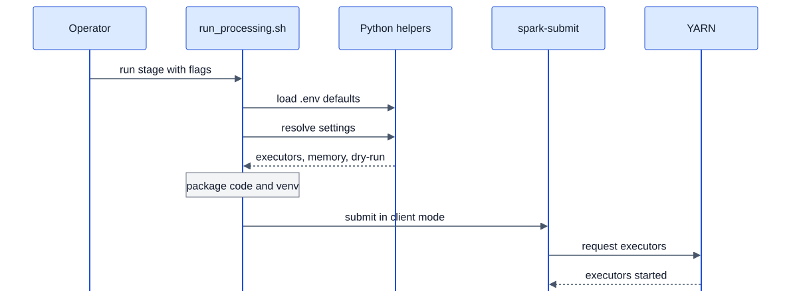

# 03. Cluster Design

This chapter explains how the project uses Spark on YARN: which process runs
where, how much memory and CPU each job asks for, how code and models reach the
workers, and how jobs fail and retry. Machines and network are in
[02-hardware-and-infrastructure.md](02-hardware-and-infrastructure.md); every
setting mentioned here is also listed in [07-configuration.md](07-configuration.md).

## 1. Roles

The launcher scripts start the Spark driver on the master and publish packaged
dependencies to an HDFS cache. The driver asks the YARN ResourceManager for
executors, which pull the cached archives, and the driver alone talks to
PostgreSQL.

*Source: docs/diagrams/src/cluster-roles.mmd*

| Role | Process | Location | Responsibilities | Confidence |
|---|---|---|---|---|
| Launcher scripts | `scripts/run_<stage>.sh` → `scripts/run_processing.sh` (bash) | Master | Load `.env`, resolve settings, package code/venv/model, publish to HDFS, call `spark-submit` | Verified in code: `scripts/run_processing.sh` |
| Spark driver | The stage's Python module (`ingestion.pipeline`, `chunking.pipeline`, `tagging.pipeline`, `embeddings.pipeline`) | Master, inside the launcher's process tree (`--deploy-mode client`) | Holds the advisory lock, reads pending work, builds tasks, commits results | Verified in code: `scripts/run_processing.sh:141`, `jobs/runtime.py:15-32` |
| YARN ResourceManager | Hadoop service | Master | Grants containers | Verified in code: `--master yarn` (`scripts/run_processing.sh:141`); location Inferred (legacy doc `archive/validation.md:80`) |
| YARN ApplicationMaster | Spark client-mode AM container | One worker | Negotiates executor containers; in client mode it does not run the driver | Inferred: standard Spark-on-YARN client mode; `archive/processing.md:102-103` says it occupies one worker |
| Executors | Python workers inside YARN containers, interpreter `./environment/bin/python` | Workers | Run the pure transform functions (`process_file_chunk`, `process_batch`) | Verified in code: `scripts/run_processing.sh:133, 153`, `jobs/batching.py:80-87` |
| HDFS app cache | Directory `HDFS_APPS_DIR` (default `/user/$USER/apps/spark`) | HDFS | Stores fingerprinted venv, model and Spark-jar archives reused across runs | Verified in code: `scripts/run_processing.sh:89, 102-127` |
| PostgreSQL | Database server | See [02](02-hardware-and-infrastructure.md#1-topology) | Single source of truth for all state | Verified in code: `db/db_handler.py` |

## 2. Execution model

| Rule | Value | Confidence |
|---|---|---|
| Cluster manager and deploy mode | YARN, client mode | Verified in code: `scripts/run_processing.sh:141` |
| Cores per executor | 1 | Verified in code: `scripts/run_processing.sh:145` |
| Executor count | Fixed per run (`spark.executor.instances`); dynamic allocation disabled | Verified in code: `scripts/run_processing.sh:146-147` |
| Native threads per executor | 1 (`RAYON_NUM_THREADS`, `OMP_NUM_THREADS`, `OPENBLAS_NUM_THREADS`, and ONNX intra-op threads for embedding) | Verified in code: `scripts/run_processing.sh:27, 149-151`; `jobs/runtime.py:124` |
| Python worker reuse | Enabled, so models and detectors load once per Python worker | Verified in code: `jobs/runtime.py:96`; `ingestion/extraction.py:22-23` |
| Task granularity | One Spark partition per task. Ingestion submits one job per wave; the other stages submit each task as its own single-partition job, at most `parallel_tasks` at a time. | Verified in code: `jobs/batching.py:38-91`; `ingestion/pipeline.py:551` |
| Who writes to PostgreSQL | Driver only | Verified in code: see [01 section 5](01-system-overview.md#5-design-principles-that-hold-across-the-system) |
| Spark master override | `SPARK_MASTER_URL`, if set, is applied in the session builder (used by tests with `local[3]`) | Verified in code: `jobs/runtime.py:104-105`; `tests/test_job_runtime.py:69` |

## 3. Resource sizing per stage

Defaults when no flag or environment variable overrides them.

| Stage | Executors | Concurrent tasks | Driver memory | Executor memory | Executor overhead | Container request per executor | Confidence |
|---|---|---|---|---|---|---|---|
| Ingestion | 3 | `MAX_FILES_PER_ROUND` = executor count | 512m | 512m | 512m | ~1 GiB | Verified in code: `ingestion/pipeline.py:104-117`, `jobs/launch_config.py:24-30` |
| Chunking | 3 | `CHUNK_MAX_PARALLEL_TASKS` = executor count | 512m | 512m | 512m | ~1 GiB | Verified in code: `jobs/runtime.py:66-75`, `jobs/launch_config.py:29-30` |
| Tagging | 3 | `TAG_MAX_PARALLEL_TASKS` = executor count | 512m | 512m | 512m | ~1 GiB | Verified in code: as above |
| Embedding | 2 | `EMBED_MAX_PARALLEL_TASKS` = executor count | 512m | 512m (`EMBEDDING_EXECUTOR_MEMORY`) | 1g (`EMBEDDING_EXECUTOR_MEMORY_OVERHEAD`) | ~1.5 GiB | Verified in code: `jobs/runtime.py:67`, `jobs/launch_config.py:25-27`, `.env.example:13-15` |

Notes:

- The "container request" column adds executor memory and overhead. YARN rounds
  each request up to its minimum allocation, which is not in the repository:
  [[FILL: yarn.scheduler.minimum-allocation-mb and yarn.nodemanager.resource.memory-mb on the workers]].
  *Inferred: standard YARN behaviour.*
- The embedding sizing is documented as "one 1.5 GiB YARN container on each
  2 GiB worker". *Verified in code: `.env.example:13`; `archive/processing.md:95-96`.*
- Measured memory, legacy validation (3-file ingestion smoke on YARN): Python
  RSS about 195-221 MiB, JVM RSS about 223-233 MiB per executor, driver JVM RSS
  about 400 MiB. *Inferred (legacy doc `archive/validation.md:98-100`).*
- Ingestion payload bounds: at most 4 MiB of candidate JSON per task, so about
  12 MiB per three-task wave. These bound payloads, not process memory.
  *Verified in code: `ingestion/pipeline.py:70, 119`; `sparc_baseline/README.md:177-181`.*
- Cluster capacity check: three workers at 2 GiB each can host three 1 GiB
  ingestion containers only if the ApplicationMaster container fits next to one
  of them. Whether all three executors actually start at default settings is
  not recorded for the processing stages:
  [[FILL: number of executors YARN actually grants for chunking and tagging at default settings]].
  *Inferred.*

## 4. Spark settings applied by the code

| Setting | Value | Stages | Set in | Confidence |
|---|---|---|---|---|
| `spark.app.name` | `CC-NEWS-Bounded-Ingest` or `News-<stage>` | All | `jobs/runtime.py:95` | Verified in code |
| `spark.python.worker.reuse` | `true` | All | `jobs/runtime.py:96` | Verified in code |
| `spark.redaction.regex` | `(?i)secret\|password\|token\|access[.]?key\|api[._]?key` | All | `jobs/runtime.py:97` | Verified in code |
| `spark.redaction.string.regex` | `gsk_[A-Za-z0-9]+` (Groq key format) | All | `jobs/runtime.py:98` | Verified in code |
| `spark.task.maxDirectResultSize` | `16m` | Ingestion | `jobs/runtime.py:99-101` | Verified in code |
| `spark.speculation` | `false` | Chunk, tag, embed | `jobs/runtime.py:103`; `scripts/run_processing.sh:138` | Verified in code |
| `spark.task.maxFailures` | `1` | Chunk, tag, embed | `jobs/runtime.py:103`; `scripts/run_processing.sh:138` | Verified in code |
| `spark.executor.cores` | `1` | All | `scripts/run_processing.sh:145` | Verified in code |
| `spark.executor.instances` | resolved executor count | All | `scripts/run_processing.sh:146` | Verified in code |
| `spark.dynamicAllocation.enabled` | `false` | All | `scripts/run_processing.sh:147` | Verified in code |
| `spark.driver.maxResultSize` | `64m` | All | `scripts/run_processing.sh:148` | Verified in code |
| `spark.executor.memoryOverhead` | resolved overhead | All | `scripts/run_processing.sh:144` | Verified in code |
| `spark.yarn.archive` | `hdfs://<HDFS_APPS_DIR>/spark-libs-<hash>.zip` | All, when the HDFS cache is used | `scripts/run_processing.sh:116-126` | Verified in code |
| `spark.pyspark.python` / `spark.pyspark.driver.python` | `./environment/bin/python` / `<venv>/bin/python` | All | `scripts/run_processing.sh:132-133, 152-153` | Verified in code |
| `spark.executorEnv.*` | `RAYON/OMP/OPENBLAS_NUM_THREADS=1`; tagging: `GROQ_API_KEY`, `TAG_REQUEST_INTERVAL_SECONDS`, `TAG_PARALLELISM`, optional `TAG_REQUESTS_PER_MINUTE`, `TAG_TOKENS_PER_MINUTE`; embedding: `EMBEDDING_MODEL_DIR=./embedding-model`, `EMBEDDING_MAX_LENGTH`, `EMBEDDING_BATCH_SIZE`, `EMBEDDING_INTRA_OP_THREADS=1` | As listed | `scripts/run_processing.sh:149-151`; `jobs/runtime.py:106-124` | Verified in code |

Cluster-level Spark defaults (`spark-defaults.conf`), such as event logging,
are not in the repository: [[FILL: contents of spark-defaults.conf on the master]].
Event logs were written under `/spark-logs` during the legacy validation.
*Inferred (legacy doc `archive/validation.md:104`).*

## 5. Packaging and distribution

Every non-dry-run launch prepares up to four artifacts. Fingerprints make them
reusable, so a repeat launch with unchanged dependencies uploads nothing new.

| Artifact | Built from | Fingerprint | Reaches executors as | Confidence |
|---|---|---|---|---|
| Project code ZIP | `ingestion db chunking tagging embeddings jobs` (no `__pycache__`) | None, rebuilt every launch | `--py-files project_code.zip` | Verified in code: `scripts/run_processing.sh:48-49, 154` |
| Worker virtual environment | `venv-pack` of `.venv` (or `.venv-embedding-onnx` for embedding) | SHA-256 of the stage's requirements files, `pyvenv.cfg`, installed distributions, Python version and path | `--archives ...#environment` (local file or HDFS copy) | Verified in code: `scripts/run_processing.sh:68-88, 103-107` |
| Embedding model archive | `tar` of `EMBEDDING_MODEL_DIR` | SHA-256 of all model files | `--archives ...#embedding-model`; executors read `./embedding-model` | Verified in code: `scripts/run_processing.sh:51-66, 108-115, 128-131`; `jobs/runtime.py:121` |
| Spark jars archive | ZIP of `$SPARK_HOME/jars/*.jar` | SHA-256 of all jars | `spark.yarn.archive` | Verified in code: `scripts/run_processing.sh:116-126` |

Rules:

- HDFS caching is on by default (`USE_HDFS_CACHE=1`) and is used only if
  `hdfs dfs -test -e /` succeeds; otherwise archives are uploaded per run.
  *Verified in code: `scripts/run_processing.sh:102`.*
- Uploads go to a temporary name and are renamed into place, so concurrent
  launches never see a half-written archive. *Verified in code: `scripts/run_processing.sh:92-100`.*
- Nothing deletes old archives from HDFS or `.build-tmp/`. *Verified in code:
  no cleanup step exists; stated in `archive/architecture.md:115-116`.*
- `retrieval/` is not packaged because the RAG agent never runs on Spark.
  *Verified in code: `scripts/run_processing.sh:49`.*

## 6. Job submission sequence

Every stage starts the same way. The shell launcher first re-executes itself
through a Python helper that loads `.env`, then resolves the final settings
with the same parser the job uses, packages the artifacts, and submits to YARN
in client mode.

*Source: docs/diagrams/src/job-submission.mmd*

| Step | What happens | Confidence |
|---|---|---|
| 1. Run stage | `run_ingestion.sh`, `run_chunking.sh`, `run_tagging.sh` or `run_embeddings.sh` calls `run_processing.sh <stage>`. | Verified in code: `scripts/run_*.sh:3` |
| 2. Load `.env` | `jobs/environment.py` records the names of variables that were already exported (`SPARK_WARC_EXPORTED_ENV_KEYS`), loads `.env` without overriding them, and `exec`s the launcher again with `--env-loaded`. | Verified in code: `scripts/run_processing.sh:5-13`; `jobs/environment.py:15-23` |
| 3. Resolve settings | `python -m jobs.launch_config <stage> <args>` prints executor count, dry-run flag, driver memory, executor memory and overhead. `--help` and `--dry-run` stop here and run the module locally. | Verified in code: `scripts/run_processing.sh:32-43`; `jobs/launch_config.py:8-37` |
| 4. Package | Build or reuse the code ZIP, venv archive, model archive (embedding) and jar archive; publish to HDFS when enabled. | Verified in code: `scripts/run_processing.sh:44-131` |
| 5. Submit | `spark-submit --master yarn --deploy-mode client ... scripts/<stage>.py <args>`. Ingestion uses `spark-submit` from `PATH`; the other stages use `$SPARK_HOME/bin/spark-submit`. | Verified in code: `scripts/run_processing.sh:134-154` |
| 6. Executors | YARN starts the requested executors; the driver begins waves. | Verified in code (request); behaviour is standard Spark |

## 7. Coordination between jobs

| Concern | Behaviour | Confidence |
|---|---|---|
| Two ingestion runs at once | Refused: the second coordinator fails to take the global advisory lock (`another ingestion coordinator is active`). | Verified in code: `db/db_handler.py:192-203` |
| Two runs of the same processing stage | Refused: per-stage lock `spark-warc-<stage>` (`chunking`, `tagging`, `embedding`). | Verified in code: `db/chunks.py:13-25`; `jobs/runtime.py:22` |
| Different stages at the same time | Allowed by the locks. Each run picks up only rows committed before its source query started. | Verified in code: separate lock keys; `archive/processing.md:177-179` |
| Shared cluster capacity | Two simultaneous stages compete for the same three workers; nothing in the code arbitrates this. | Inferred |
| Team practice | [[FILL: whether the team runs several stages at the same time on the cluster]] | Blank |

## 8. Failure and retry policy

| Stage | Spark task retries | Application-level retries | On failure | Confidence |
|---|---|---|---|---|
| Ingestion | Spark default (not overridden) | Worker: up to `MAX_RETRIES` (3) attempts for transient HTTP/network errors with exponential backoff capped at 30 s. Driver: up to `MAX_RETRIES` commit attempts, reconnecting and re-taking the lock between attempts. | A failed file is marked `failed`, the run ends `failed` (exit 1) and can be resumed. | Verified in code: `ingestion/pipeline.py:150-157, 353-375, 554-589`; `jobs/runtime.py:99-101` |
| Chunking, tagging, embedding | `spark.task.maxFailures=1`, no speculation | Tagging (Groq): up to 5 attempts per chunk with rate-limit waits. Chunking and embedding: none. | The wave drains successful siblings, commits them, then raises (exit 1). Rerun the same command to continue. | Verified in code: `jobs/runtime.py:103`; `jobs/batching.py:38-77`; `tagging/backends/groq.py:38-92` |

Why processing stages avoid Spark retries: an external API call cannot be
committed atomically with PostgreSQL, so a retry could pay for the same call
twice. *Verified in code: comment in `jobs/batching.py:41-42`; explanation in
`archive/processing.md:170-175`.*

## 9. Cluster services configuration

The Hadoop and YARN configuration files live on the VMs, not in the repository.

| Item | Value | Confidence |
|---|---|---|
| HDFS replication factor | [[FILL: dfs.replication value]] | Blank |
| HDFS NameNode and DataNode placement | [[FILL: which VMs run the NameNode and the DataNodes]] | Blank |
| YARN NodeManager placement | Workers (`worker1`-`worker3`) | Inferred (legacy doc `archive/validation.md:97`) |
| YARN log aggregation | [[FILL: whether yarn.log-aggregation-enable is on and where logs are kept]] | Blank |
| Start/stop procedure | `cluster_up.sh` / `cluster_down.sh` on the Debian host (not in repo) | Verified in code: `sparc_baseline/README.md:94-96` |

## 10. Production cluster

Production mode is **Proposed (not implemented)**. The proposed direction keeps
the same Spark stages but changes who starts them:

- A continuously running ingestion service would watch the CC-NEWS manifest and
  reuse the existing checkpoint tables (`ingest_files`, `ingest_runs`,
  `ingest_run_files`, `ingest_chunks`) to start bounded ingestion waves.
  *Proposed (not implemented).*
- Chunking, tagging and embedding would run on a schedule, one stage at a time
  or with explicit capacity limits, because the current three 2 GiB workers
  cannot host several stages comfortably. *Proposed (not implemented);
  capacity reasoning Inferred.*
- The query service (FastAPI in `query_service/`) would run outside YARN on an
  always-on host. *Proposed (not implemented).*

Details and trade-offs are in [10-prototype-vs-production.md](10-prototype-vs-production.md).
